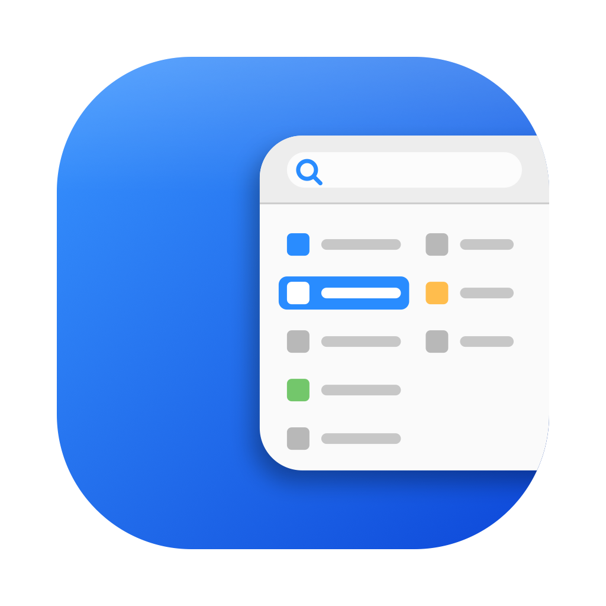
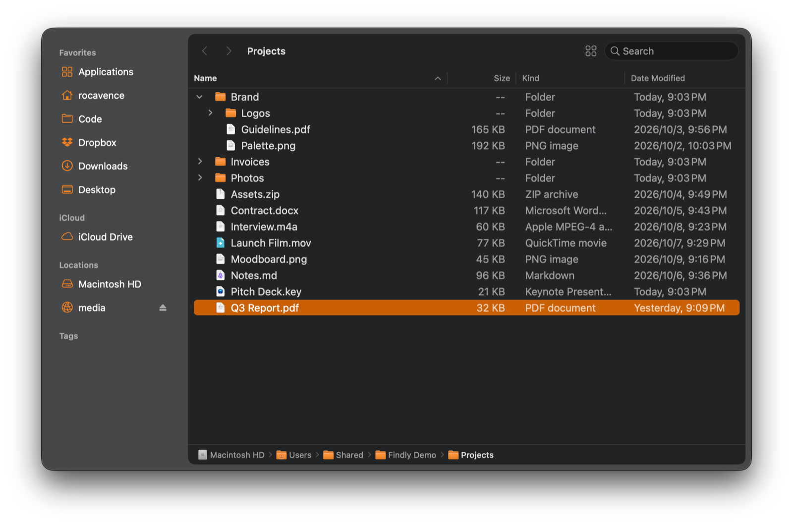
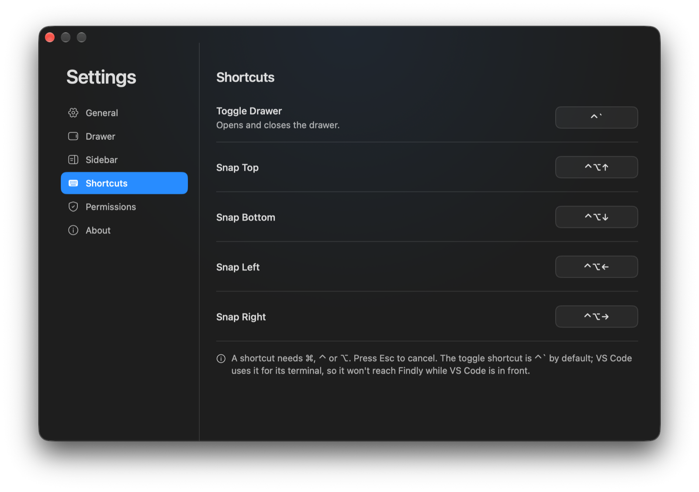
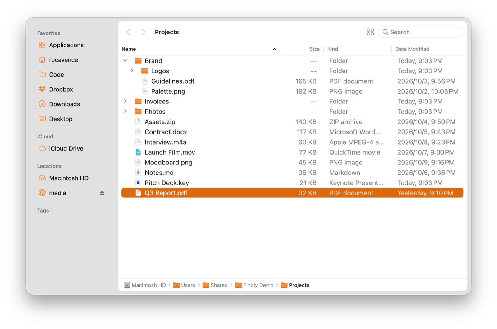

<p align="center">
  
</p>

<h1 align="center">Findly</h1>

<p align="center">
  Press <b>⌃`</b> and a Finder-style file drawer slides in from any edge of the screen.<br>
  Grab a file, switch back to what you were doing, and it slides away.
</p>

<p align="center"><a href="https://findly.rocavence.com">findly.rocavence.com</a> · <a href="README.md">繁體中文</a> · <b>English</b></p>

<p align="center">
  
</p>

## Install

```sh
brew install --cask rocavence/tap/findly
```

Or download `Findly-x.y.z.zip` from [Releases](https://github.com/rocavence/Findly-app/releases/latest), unzip it, and drag **Findly** into Applications. It's self-signed (not notarized by Apple), so the first launch needs right-click → Open, or `xattr -dr com.apple.quarantine /Applications/Findly.app`. Homebrew handles that for you.

Findly browses the whole disk, so it needs Full Disk Access: turn on Findly in System Settings › Privacy & Security › Full Disk Access. Settings › Permissions shows whether it's on. Without it, Desktop, Documents, Downloads and external drives can't be opened, and the drawer says so, with a button to the right settings pane. Requires macOS 14 or later.

## Use

| Action | How |
|---|---|
| Open or close the drawer | `` ⌃` ``, or click the menu bar icon (right-click for the menu) |
| Open on a given edge | `⌃⌥` + arrow |
| Close | Switch to another app (can be turned off), or press the shortcut again |
| Open a file or folder | Double-click, `⌘↓`, `⌘O` |
| Back / Forward / Up | `⌘[`, `⌘]`, `⌘↑`, or the mouse's side buttons |
| Rename | `Return` (selects the name without its extension) |
| Move to Trash | `⌘⌫` |
| Quick Look | Space; `⌥` Space for full screen; works on several files |
| Search | `⌘F`; this folder, or its subfolders too (via Spotlight) |
| Show hidden files | `⌘⇧.` |
| Resize | Drag the drawer's inner edge; width and height are remembered separately, up to 85% of the screen |

Every shortcut can be changed in Settings › Shortcuts. The recorder refuses combos already used by another action or by macOS, and marks any shortcut another app has taken. VS Code uses `` ⌃` `` for its terminal, so while VS Code is in front, it gets that shortcut.

## What it does

- **Finder's own sidebar**: Favorites in Finder's order, iCloud Drive, Locations (eject external and network drives right there; updates as they come and go) and Tags (shows every file with that tag; folded at first). Turn each item on or off in Settings › Sidebar, as in Finder.
- **Finder's list view**: Name, Size, Kind and Date Modified, sortable by header, grouped by kind if you like, with folders that expand in place. Text follows Finder's View Options size.
- **Stays current**: FSEvents watches the folder and any expanded ones; a refresh keeps what's expanded, selected and scrolled.
- **Drag and drop**: drag files out into any app, or in: onto the list, a folder row, the sidebar or the path bar. Moves within a disk and copies across, like Finder; a clashing name gets a number instead of overwriting. Progress shows above the list.
- **On every Space**: the drawer is Findly's own window, so it opens over full-screen apps too, always on the screen the pointer is on.
- **Six languages**: 繁體中文, English, 日本語, 한국어, Español, Português (Brasil).

<table>
  <tr>
    <td width="50%"></td>
    <td width="50%"></td>
  </tr>
</table>

## Build from source

```sh
brew install xcodegen
./scripts/build-app.sh --install      # builds dist/Findly-<version>.zip and installs it
```

Put your signing identity in `Config/Signing.local.xcconfig` (`CODE_SIGN_IDENTITY = …`); with a stable identity, Full Disk Access survives rebuilds.

```sh
xcodebuild test -project Findly.xcodeproj -scheme Findly   # unit tests
./scripts/selftest.sh [item]                                 # end-to-end, in a fake folder tree
./scripts/screenshots.sh [language] [light|dark]             # README and website shots
```

```
Findly/
├── App/          entry point, menu bar, preferences, update check, self-test
├── Drawer/       drawer window, slide in and out, screen-edge geometry
├── Browser/      the browser: file list, sidebar, path bar, notices
├── Model/        file items, folder reading, sorting and grouping, history, FSEvents watcher
├── Services/     file operations, Finder's sidebar, Spotlight, Full Disk Access
├── Hotkeys/      global shortcuts (Carbon RegisterEventHotKey)
├── Settings/     the settings card
└── DesignSystem/ type, spacing, colours, accent, Reicon icons
scripts/          build-app.sh, selftest.sh, screenshots.sh, update-cask.py, icon/, reicon/, l10n/
```

## Design notes

The first Findly drove a real Finder window as the drawer, opening it with AppleScript and moving it with the Accessibility API. It worked, but needed a Finder window per Space and private APIs; all the complexity came from borrowing someone else's window. Switching to its own window put it on every Space with one line of `collectionBehavior`.

Version 1.0 is a rebuild: the list and sidebar are AppKit (`NSOutlineView`), folders are read off the main thread, the drawer opens on the current screen every time with a size limit, and the default shortcut moved from `` ⌘` `` to `` ⌃` ``, giving macOS back its shortcut for cycling an app's windows. It shares its settings card, design system, six languages and update check with [Configgy](https://configgy.rocavence.com), [Gamely](https://gamely.rocavence.com) and [Flione](https://flione.rocavence.com).

<sub>Licensed under MIT · a personal tool, shared as-is, with no warranty · built with Claude Code.</sub>
