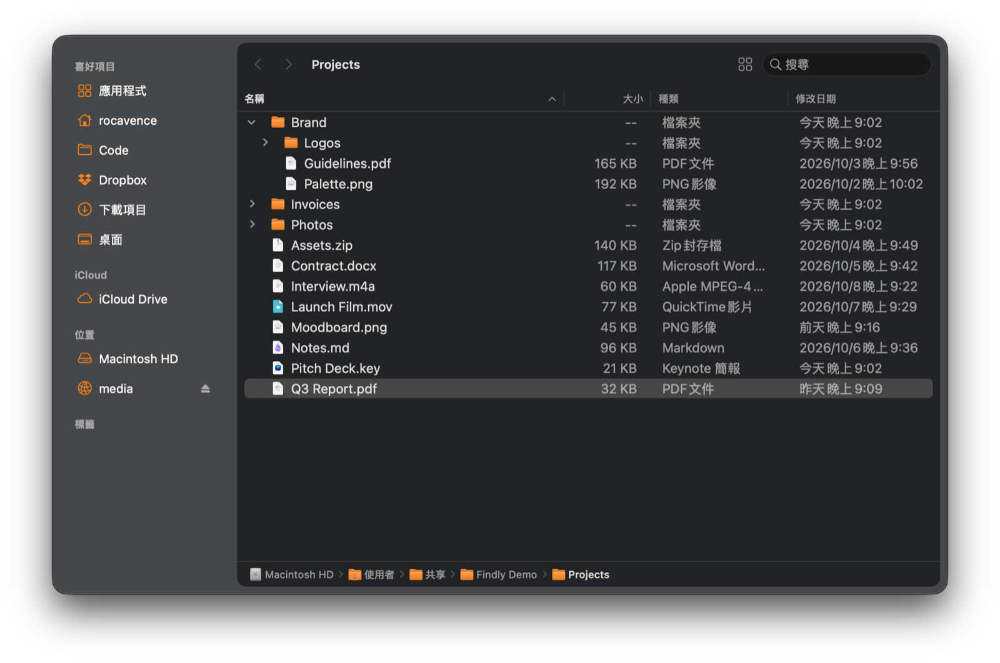
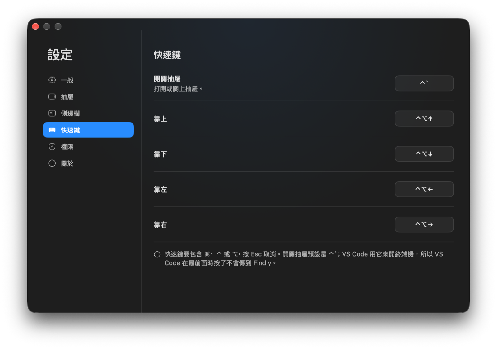
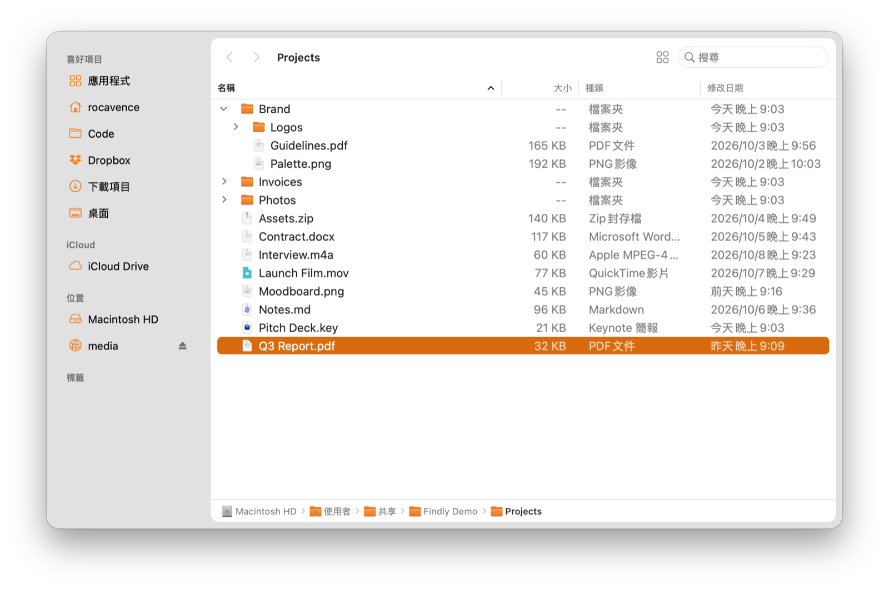

<p align="center">
  
</p>

<h1 align="center">Findly</h1>

<p align="center">
  按 <b>⌃`</b>，從螢幕任一邊滑出一個 Finder 風格的檔案抽屜。<br>
  拿完檔案、切回別的 App，它就自己收起來。
</p>

<p align="center"><a href="https://findly.rocavence.com">findly.rocavence.com</a> · <b>繁體中文</b> · <a href="README.en.md">English</a></p>

<p align="center">
  
</p>

## 安裝

```sh
brew install --cask rocavence/tap/findly
```

也可以到 [Releases](https://github.com/rocavence/Findly-app/releases/latest) 下載 `Findly-x.y.z.zip`，解壓縮後把 **Findly** 拖進「應用程式」。這是自簽的 App（沒有經過 Apple 公證），第一次開啟要按右鍵 → 打開，或執行 `xattr -dr com.apple.quarantine /Applications/Findly.app`。用 Homebrew 安裝會自動處理這一步。

Findly 要瀏覽整個磁碟，需要「完整磁碟取用權」。到「系統設定 › 隱私權與安全性 › 完整磁碟取用權」打開 Findly；設定裡的「權限」頁會顯示目前狀態。沒有開啟時，桌面、文件、下載項目與外接磁碟會打不開，抽屜會直接說明原因並附上前往設定的按鈕。需要 macOS 14 以上。

## 使用

| 動作 | 方式 |
|---|---|
| 打開／收起抽屜 | `` ⌃` ``，或點選單列圖示（按右鍵開選單） |
| 從某一邊打開 | `⌃⌥` + 方向鍵 |
| 收起 | 切到其他 App（可在設定關掉），或再按一次快速鍵 |
| 打開檔案或檔案夾 | 連按兩下、`⌘↓`、`⌘O` |
| 上一頁／下一頁／上層 | `⌘[`、`⌘]`、`⌘↑`，或滑鼠側鍵 |
| 重新命名 | `Return`（只選取主檔名，不含副檔名） |
| 丟到垃圾桶 | `⌘⌫` |
| 快速查看 | 空白鍵；`⌥` + 空白鍵全螢幕；可一次選多個 |
| 搜尋 | `⌘F`；可選「這個檔案夾」或「包含子檔案夾」（用 Spotlight） |
| 顯示隱藏檔案 | `⌘⇧.` |
| 調整大小 | 拖曳抽屜內側邊緣；寬度與高度分開記住，最多到螢幕的 85% |

快速鍵都能在「設定 › 快速鍵」更改。錄製時會擋掉和其他動作或 macOS 重複的組合；如果另一個 App 已經占用某組快速鍵，設定頁會標出來。VS Code 用 `` ⌃` `` 開終端機，所以 VS Code 在最前面時，這組快速鍵會被 VS Code 接走。

## 它做什麼

- **跟 Finder 同一份側邊欄**：喜好項目照 Finder 的順序、iCloud Drive、位置（外接與網路磁碟可直接退出，插拔時即時更新）、標籤（點了列出所有帶這個標籤的檔案，預設收起）。要顯示哪些項目，在「設定 › 側邊欄」逐項開關，跟 Finder 一樣。
- **Finder 的列表檢視**：名稱、大小、種類、修改日期四欄，點欄位標題排序，可依種類分組，檔案夾可就地展開。字級跟著 Finder「顯示方式選項」的設定。
- **檔案會自己更新**：用 FSEvents 監看目前與已展開的檔案夾，重新整理時保留展開狀態、選取與捲動位置。
- **拖放**：把檔案拖到其他 App；也能拖進抽屜、拖到檔案夾列、側邊欄或下方路徑列。同一顆磁碟搬移、跨磁碟拷貝，跟 Finder 一樣；名稱重複時自動加編號，不會覆蓋。進度顯示在列表上方。
- **出現在每個桌面空間**：抽屜是 Findly 自己的視窗，全螢幕 App 上面也叫得出來；每次都從滑鼠所在的螢幕滑出。
- **六種語言**：繁體中文、English、日本語、한국어、Español、Português (Brasil)。

<table>
  <tr>
    <td width="50%"></td>
    <td width="50%"></td>
  </tr>
</table>

## 從原始碼建置

```sh
brew install xcodegen
./scripts/build-app.sh --install      # 打包 dist/Findly-<版本>.zip 並裝到「應用程式」
```

簽章身分放在 `Config/Signing.local.xcconfig`（`CODE_SIGN_IDENTITY = …`）。用固定的身分，重建後完整磁碟取用權才不會失效。

```sh
xcodebuild test -project Findly.xcodeproj -scheme Findly   # 單元測試
./scripts/selftest.sh [項目]                                 # 端對端自我測試，在假的檔案夾裡執行
./scripts/screenshots.sh [語言] [light|dark]                 # README 與官網用的截圖
```

```
Findly/
├── App/          進入點、選單列、偏好設定、更新檢查、自我測試
├── Drawer/       抽屜視窗、滑入滑出、螢幕邊緣幾何
├── Browser/      瀏覽器：檔案列表、側邊欄、路徑列、提示列
├── Model/        檔案項目、讀取檔案夾、排序與分組、上一頁／下一頁、FSEvents 監看
├── Services/     檔案操作、Finder 側邊欄、Spotlight、完整磁碟取用權
├── Hotkeys/      全域快速鍵（Carbon RegisterEventHotKey）
├── Settings/     設定卡
└── DesignSystem/ 字級、間距、顏色、重點色、Reicon 圖示
scripts/          build-app.sh、selftest.sh、screenshots.sh、update-cask.py、icon/、reicon/、l10n/
```

## 設計筆記

最早的 Findly 想直接操控真正的 Finder 視窗當抽屜：用 AppleScript 開視窗、用 Accessibility API 搬位置。這條路跑得動，但每個桌面空間都要塞一個 Finder 視窗，還要動用私有 API，複雜度全落在「借用別人的視窗」。後來改成自己的視窗，一行 `collectionBehavior` 就出現在每個桌面空間。

1.0 是重寫：檔案列表與側邊欄都改用 AppKit（`NSOutlineView`），讀取檔案夾移到背景執行緒，抽屜改成每次從目前螢幕滑出並限制尺寸，預設快速鍵從 `` ⌘` `` 改成 `` ⌃` ``，讓出 macOS 切換同一 App 視窗的快速鍵。設定卡、設計規範、六種語言與更新檢查，都和 [Configgy](https://configgy.rocavence.com)、[Gamely](https://gamely.rocavence.com)、[Flione](https://flione.rocavence.com) 共用。

<sub>以 MIT 授權 · 個人工具，原樣分享，不提供任何保證 · 用 Claude Code 打造。</sub>
